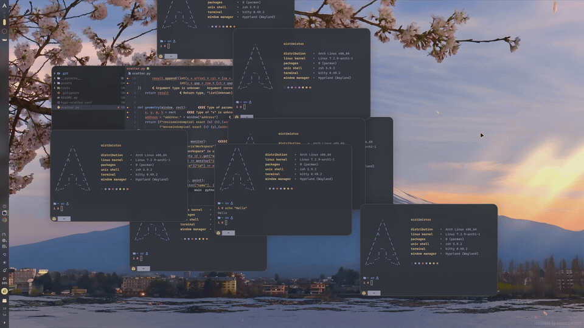

# hypr-scatter

Click empty desktop space to spread floating windows into a balanced grid.
Click a window to restore the saved positions and sizes and raise the selected
window above the others. Click empty space again or press Escape to cancel.
Cancelling restores the layout and stacking without moving the mouse pointer.
Super+F9 toggles the overview even when no desktop space is exposed.

Targets the local Hyprland 0.56.2 session. Uses Python 3's standard library and
the public `hyprctl` IPC; no binary compositor plugin or background daemon.
Hyprland's configured window-move animations animate the transition.

## Demo

[](assets/demo.mp4)

[Watch the original 4K recording (MP4, 9 seconds)](assets/demo.mp4).

## Enable

Add this line to `~/.config/hypr/hyprland.conf`, then run `hyprctl reload`:

```ini
source = /home/mist/Repositories/hypr-scatter/hypr-scatter.conf
```

The supplied bindings use this project's absolute local path. Update the paths
if moving the project. To disable, restore first, remove the source line, and
reload Hyprland.

```sh
python3 scatter.py status
python3 scatter.py restore
python3 -m unittest discover -s tests -v
```

For an opt-in live round-trip check (temporarily rearranges current windows):

```sh
python3 tests/live_check.py
```

## Behavior and limits

- Only ungrouped, unpinned floating windows on the clicked monitor's visible
  workspace participate. Tiled and fullscreen windows remain untouched.
- The grid preserves aspect ratios without enlarging windows, respects monitor
  scaling/rotation and reserved bar space, and centers incomplete rows.
- These are live, resized application windows, not scaled screenshots. Apps
  can enforce minimum sizes; very crowded grids can consequently overlap.
- Clicks are non-consuming: selecting a window can also activate the control
  under the pointer. Prefer clicking a neutral area of the window.
- Top/overlay layer rectangles are excluded. The local Noctalia transparent
  background is exempt; its separate bar/popup surfaces remain excluded.
- Original geometry is saved atomically under `$XDG_RUNTIME_DIR/hypr-scatter/`
  before moving anything. Concurrent clicks are serialized. Clicks during the
  initial 400ms transition are ignored.
- Closed windows are skipped during restoration. Windows moved to another
  workspace, tiled, or made fullscreen during the overview are left alone.
  After switching workspaces, the next desktop/window click or Escape restores
  the saved overview. Original stacking is approximated from focus history.

## Implementation

`scatter.py` owns hit testing, grid selection, geometry snapshots and restoration.
`hypr-scatter.conf` connects mouse release, cancellation and the optional keyboard
toggle to the script. No changes to Hyprland or third-party plugin source.
